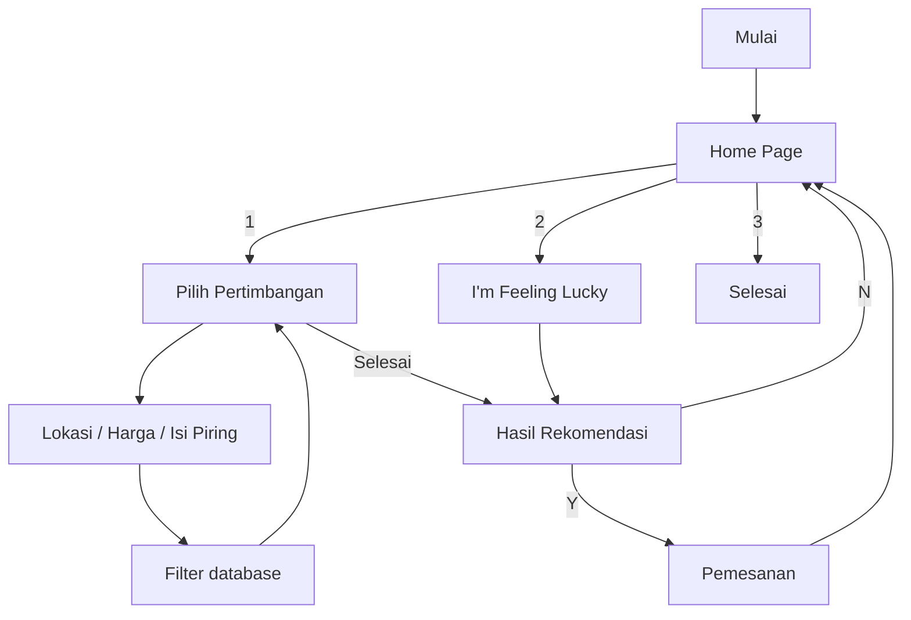

# MBG (Maba Butuh Gizi)

MBG (Maba Butuh Gizi) adalah program berbasis terminal yang dibuat untuk memenuhi penugasan **Proyek 2 Berpikir Komputasional**. MBG dihadirkan untuk menyelesaikan satu persoalan, yaitu:

> Membantu mahasiswa baru ITB untuk mengenal lebih jauh tenant-tenant makanan yang ada di kampus, sekaligus mengurangi penumpukan antrean pada jam-jam strategis.

## Daftar Isi

- [Anggota Kelompok](#anggota-kelompok)
- [Latar Belakang](#latar-belakang)
- [Fitur](#fitur)
- [Requirements](#requirements)
- [Cara Menjalankan](#cara-menjalankan)
- [Cara Kerja](#cara-kerja)
- [Struktur Proyek](#struktur-proyek)
- [Tampilan](#tampilan)

## Anggota Kelompok

| No | Nama                           | NIM          |
|:--:|:-------------------------------|:------------:|
| 1  | Davin Gusti Nurandi            | 19626014     |
| 2  | Mahesa Rahasia Hati Kahfilano  | 19626020     |
| 3  | Fathyakan Thorique Zidane      | 19626038     |
| 4  | Aksa Rachman                   | 19626104     |

## Latar Belakang

Mahasiswa baru sering belum mengetahui makanan apa saja yang dijual di tiap tenant kantin. Pada jam makan yang ramai, antrean yang panjang membuat mereka kesulitan membandingkan harga dan menu, dan akhirnya enggan mencoba tenant yang berbeda. MBG membantu mahasiswa menemukan pilihan makanan sesuai kebutuhan mereka sebelum datang ke kantin, sehingga keputusan bisa diambil lebih cepat.

## Fitur

- **Rekomendasi berdasarkan pertimbangan user**: lokasi, harga, dan isi piring.
- **I'm Feeling Lucky**: rekomendasi makanan secara acak.
- **Pemesanan untuk esok hari**: user dapat memilih waktu pengambilan makanan, sehingga antrean pada jam strategis dapat berkurang.

## Requirements

1. Python 3.10 atau lebih baru

Cek versi Python yang terpasang:

```bash
python --version
```

## Cara Menjalankan

1. Clone repository ini:

   ```bash
   git clone https://github.com/aksarachman3-cmd/MBG-MABA-BUTUH-GIZI.git
   cd MBG-MABA-BUTUH-GIZI
   ```

2. Jalankan program:

   ```bash
   python main.py
   ```

3. Ikuti petunjuk yang muncul di layar dengan memasukkan angka sesuai pilihan.

## Cara Kerja

Program bekerja dengan kerangka berpikir sebagai berikut:

1. Program menampilkan home page dengan tiga pilihan: berikan rekomendasi, I'm Feeling Lucky, dan Exit.
2. Setiap kali kembali ke home page, state sesi di-reset melalui `sc.reset_state()`.
3. Jika user memilih rekomendasi, pertimbangan dalam `daftar_pertimbangan` (Lokasi, Harga, Isi Piring) diproses satu per satu secara sequential.
4. Setiap pertimbangan dipilih lewat halaman penentuannya, lalu data difilter dengan `check_lokasi`, `check_harga`, atau `check_isi_piring`.
5. Hasil filter ditampilkan di halaman Hasil Rekomendasi, lalu user ditanya apakah ingin memesan untuk esok hari.
6. Jika user menjawab Y, user memilih slot waktu pengambilan di halaman Pemesanan.
7. I'm Feeling Lucky mengambil satu entri acak dari `database.py` dan langsung menanyakan pemesanan.

### Alur Program



## Struktur Proyek

| Path | Isi |
|---|---|
| `main.py` | Alur kerja dan routing utama program |
| `shortcuts.py` | Kontrak seluruh fungsi bersama (nama, parameter, return) dan state sesi |
| `database.py` | Data tenant, lokasi, harga, dan kandungan piring |
| `docs/` | Pedoman pengerjaan task dan framework git |
| `task/` | Spesifikasi task per anggota, satu file untuk setiap ID task |
| `.github/` | Template pull request |

Setiap anggota mengerjakan file di folder namanya masing-masing sesuai ID task. Fungsi yang dipakai bersama didefinisikan lebih dulu di `shortcuts.py`.

## Tampilan

User akan melihat beberapa halaman yang menyesuaikan dengan pilihan yang dimasukkan.

### Home Page

*Home Page* adalah tampilan awal yang dilihat user saat menjalankan program.

```text
===========================
   MBG (MABA BUTUH GIZI)
===========================

Selamat Datang di MBG!

1. Berikan Rekomendasi Makanan
2. I'm Feeling Lucky (Makanan Random)
3. Exit

Masukkan pilihan (1-3) =
```

### Berikan Rekomendasi Makanan Page

Tampilan yang dilihat user jika memilih **1** di *Home Page*.

```text
===========================
Berikan Rekomendasi Makanan
===========================

Pilihlah Pertimbangan Pertama Anda
1. Lokasi
2. Harga
3. Isi Piring
4. Kembali

Masukkan pilihan (1-4) =
```

### I'm Feeling Lucky Page

Tampilan yang dilihat user jika memilih **2** di *Home Page*.

```text
===========================
    I'm Feeling Lucky
===========================

Makan siangmu kali ini adalah ........

Nama makanan : <nama makanan>
Harga        : <harga>
Tenant       : <nama tenant>
Lokasi       : <lokasi>

Apakah Anda ingin memesan untuk besok (Y/N) ?
```

### Penentuan Lokasi Page

Tampilan yang dilihat user saat menentukan lokasi kantin yang ingin dituju.

```text
===========================
     Penentuan Lokasi
===========================

Pilihlah Lokasi Kantin yang Ingin Dituju
1. Masjid Alwassat
2. GKU 2
3. TB3
4. TB2
5. KOICA
6. Kembali

Masukkan pilihan (1-6) =
```

### Penentuan Harga Page

Tampilan yang dilihat user saat menentukan rentang harga makanan.

```text
===========================
     Penentuan Harga
===========================

Pilihlah Range Harga yang Diinginkan (Rp)
1. < 10.000
2. 10.000 - < 15.000
3. 15.000 - < 20.000
4. 20.000 - < 25.000
5. 25.000 - < 30.000
6. >= 30.000
7. Kembali

Masukkan pilihan (1-7) =
```

### Penentuan Isi Piring Page

Tampilan yang dilihat user saat menentukan komponen penyusun makanan.

```text
===========================
   Penentuan Isi Piring
===========================

Pilihlah Isi Piringmu (Bisa Multiple)
1. Nasi
2. Protein hewani
3. Protein nabati
4. Sayur
5. Kembali

Masukkan pilihan (1-5) =
```

### Hasil Rekomendasi Page

Tampilan yang dilihat user setelah semua pertimbangan diisi.

```text
===========================
     Hasil Rekomendasi
===========================

Berikut Beberapa Pilihan Makananmu:

1. Nama makanan : <nama makanan>
   Harga        : <harga>
   Tenant       : <nama tenant>
   Lokasi       : <lokasi>

2. Nama makanan : <nama makanan>
   Harga        : <harga>
   Tenant       : <nama tenant>
   Lokasi       : <lokasi>

dst.

Apakah Anda ingin memesan untuk besok (Y/N) ?
```

### Pemesanan Page

Tampilan yang dilihat user saat ingin memesan makanan untuk esok hari.

```text
===========================
     Pemesanan Makanan
===========================

Pilih Waktu Pengambilan:
1. 9.00-10.00
2. 10.00-11.00
3. 11.00-12.00
4. 12.00-13.00
5. 13.00-14.00
6. Kembali

Masukkan pilihanmu (1-6) =
```